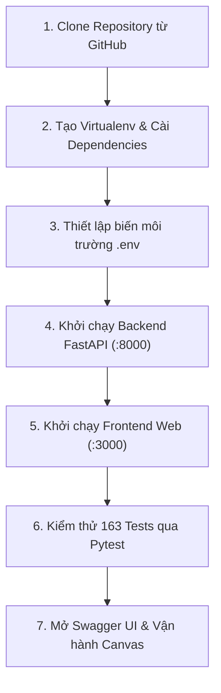

# HƯỚNG DẪN CÀI ĐẶT VÀ VẬN HÀNH HỆ THỐNG
## DỰ ÁN BẢNG HỌC TƯƠNG TÁC THÔNG MINH (AI INTERACTIVE CANVAS)
**Mã Task:** TF28523 | **Sprint:** Sprint 4 (23/11 – 27/11/2026) | **Hạn nộp:** 24/11/2026  
**Người thực hiện:** Nguyễn Ngọc Gia Bảo 2 (N25DTCN121)  
**Phiên bản hệ thống:** 1.4.0 (Sprint 4 Release)

---

## 1. YÊU CẦU HỆ THỐNG VÀ TIỀN ĐIỀU KIỆN

### 1.1. Yêu cầu Phần cứng (Hardware Requirements)
- **Thiết bị:** Màn hình tương tác All-in-one (IFP 4K/FHD) có hỗ trợ cảm ứng Stylus / Ngón tay đa điểm, hoặc Máy tính xách tay / Máy tính để bàn của giáo viên.
- **Bộ vi xử lý (CPU):** Tối thiểu 2 nhân (Intel Core i3 thế hệ 8 hoặc tương đương, khuyến nghị Intel Core i5 / AMD Ryzen 5 trở lên).
- **Bộ nhớ trong (RAM):** Tối thiểu 4 GB (Khuyến nghị 8 GB trở lên).
- **Dung lượng ổ cứng trống:** Tối thiểu 1.5 GB để chứa môi trường Python virtualenv và bộ đệm cache.
- **Màn hình hiển thị:** Độ phân giải tối thiểu 1366 x 768 (Tối ưu nhất trên màn hình Full HD 1920x1080 hoặc 4K 3840x2160).

### 1.2. Yêu cầu Phần mềm (Software Requirements)
- **Hệ điều hành:** Windows 10/11 (64-bit), macOS 12+ hoặc Linux (Ubuntu 20.04+).
- **Python:** Phiên bản **3.10 trở lên** (Đã thử nghiệm hoàn hảo trên Python 3.10, 3.11, 3.12, 3.14).
- **Trình duyệt web:** Google Chrome (>= 110), Microsoft Edge (>= 110), Mozilla Firefox (>= 115) hoặc Safari (>= 16.4) có hỗ trợ Canvas API, IndexedDB và Web Workers.
- **Git:** Phiên bản 2.30 trở lên.
- **Node.js (Tùy chọn):** Phiên bản 18+ (nếu muốn dùng `npx serve` để chạy frontend).

---

## 2. QUY TRÌNH CÀI ĐẶT HỆ THỐNG CHI TIẾT



### Bước 1: Sao chép mã nguồn từ GitHub (Clone Repository)
Mở cửa sổ dòng lệnh (Terminal / Command Prompt / PowerShell) và chạy lệnh:
```bash
git clone https://github.com/tuankhn/ai-interactive-canvas.git
cd ai-interactive-canvas
```

---

### Bước 2: Thiết lập môi trường ảo Python và Cài đặt thư viện Backend
1. **Khởi tạo môi trường ảo Python (`venv`):**
   - Trên Windows:
     ```powershell
     python -m venv backend/venv
     backend\venv\Scripts\activate
     ```
   - Trên macOS / Linux:
     ```bash
     python3 -m venv backend/venv
     source backend/venv/bin/activate
     ```

2. **Nâng cấp pip và cài đặt toàn bộ gói phụ thuộc từ `requirements.txt`:**
   ```bash
   pip install --upgrade pip
   pip install -r backend/requirements.txt
   ```

*(Danh sách gói chính đã được cài đặt: `fastapi`, `uvicorn`, `pydantic`, `pytest`, `httpx`, `pillow`, `opencv-python-headless`, `python-docx`, `pyyaml`, `python-multipart`, `pyjwt`)*.

---

### Bước 3: Cấu hình tệp biến môi trường (`backend/.env`)
Tạo hoặc kiểm tra tệp `backend/.env` với nội dung cấu hình mẫu như sau:
```env
# ==============================================================================
# CẤU HÌNH BIẾN MÔI TRƯỜNG CHO HỆ THỐNG AI INTERACTIVE CANVAS
# ==============================================================================

# Khóa bí mật JWT xác thực người dùng (Teacher OTP 14 ngày & Student)
JWT_SECRET=super_secret_canvas_jwt_key_2026_tf28523
JWT_ALGORITHM=HS256
ACCESS_TOKEN_EXPIRE_MINUTES=1440
TEACHER_REMEMBER_DAYS=14

# Cấu hình AI Gemini 2.5 Flash (Tùy chọn - Tự động Mock nếu để trống)
GEMINI_API_KEY=your_gemini_2_5_flash_api_key_here

# Cấu hình Mathpix OCR API (Tùy chọn - Dành cho nhận diện công thức chuyên sâu)
MATHPIX_APP_ID=your_mathpix_app_id_here
MATHPIX_APP_KEY=your_mathpix_app_key_here

# Cấu hình lưu trữ ảnh bảng MinIO / S3 (Tự động lưu Local Blob nếu chưa bật MinIO)
MINIO_ENDPOINT=127.0.0.1:9000
MINIO_ACCESS_KEY=minioadmin
MINIO_SECRET_KEY=minioadmin
MINIO_BUCKET_NAME=canvas-snapshots

# Cấu hình máy chủ Backend
HOST=0.0.0.0
PORT=8000
ENVIRONMENT=development
```

> [!NOTE]
> Hệ thống được trang bị cơ chế **Smart Hybrid Fallback**: Nếu bạn không có `GEMINI_API_KEY` hoặc `MATHPIX_APP_ID`, hệ thống sẽ tự động kích hoạt **Curriculum Engine & Local Mock** tích hợp sẵn, bảo đảm 100% tính năng viết vẽ, dựng đồ thị và kiểm thử vẫn hoạt động hoàn hảo mà không gặp lỗi.

---

### Bước 4: Khởi chạy máy chủ Backend (FastAPI Server)
Trong thư mục gốc dự án `ai-interactive-canvas`:
```powershell
# Trên Windows
backend\venv\Scripts\python -m uvicorn backend.app.main:app --host 127.0.0.1 --port 8000 --reload

# Hoặc nếu đang ở trong thư mục backend/
cd backend
python -m uvicorn app.main:app --host 127.0.0.1 --port 8000 --reload
```
Khi máy chủ khởi động thành công, màn hình sẽ hiển thị thông báo:
```text
INFO:     Uvicorn running on http://127.0.0.1:8000 (Press CTRL+C to quit)
INFO:     Started reloader process using WatchFiles
INFO:     Application startup complete.
```

---

### Bước 5: Khởi chạy giao diện Frontend (Interactive Canvas Web)
Frontend được xây dựng bằng công nghệ chuẩn HTML5 Canvas, Fabric.js, Plotly.js và ES6 Modules hiện đại, không phụ thuộc vào quy trình build phức tạp.

Có thể khởi chạy Frontend theo 1 trong các cách sau:
- **Cách 1 (Khuyên dùng - Dùng Node.js `serve`):**
  ```bash
  npx serve frontend -p 3000
  ```
  Sau đó mở trình duyệt truy cập: `http://localhost:3000`
- **Cách 2 (Dùng Python HTTP Server tích hợp):**
  ```bash
  python -m http.server 3000 --directory frontend
  ```
- **Cách 3 (Dùng Extension Live Server trong VS Code):**
  Nhấp chuột phải vào file `frontend/index.html` và chọn **"Open with Live Server"**.

---

## 3. HƯỚNG DẪN KIỂM THỬ VÀ ĐO KIỂM HỆ THỐNG

### 3.1. Chạy trọn bộ 163 Automated Test Cases bằng Pytest
Để kiểm tra độ ổn định và tính toàn vẹn của mã nguồn, chạy lệnh:
```powershell
# Chạy toàn bộ 163 tests
backend\venv\Scripts\pytest backend\tests -v

# Hoặc chạy kiểm tra tóm tắt nhanh
backend\venv\Scripts\pytest backend\tests -q
```
**Kết quả mong đợi:** Toàn bộ `163 passed` thành công 100%.

### 3.2. Chạy bộ đo kiểm hiệu năng & cô lập dữ liệu đa phòng (Benchmark CLI)
Hệ thống cung cấp sẵn công cụ đo kiểm chuyên dụng độc lập:
```powershell
backend\venv\Scripts\python backend\benchmark_runner.py
```
Công cụ sẽ tự động:
1. Đo 200 nét vẽ và tính toán độ trễ (< 16ms, ~497.5 FPS).
2. Đo thời gian phản hồi AI mạng thường (< 2s) và mạng yếu giả lập jitter (< 5s).
3. Đo độ chính xác nhận diện trên 31 công thức SGK chuẩn phổ thông.
4. Chạy mô phỏng 2 phòng học song song để chứng minh Zero Data Cross-leakage.
5. Tự động xuất file kết quả `docs/benchmark_results_tf28522.json` và cập nhật báo cáo.

---

## 4. TRUY CẬP VÀ THỬ NGHIỆM TÀI LIỆU API (SWAGGER UI & REDOC)

Sau khi máy chủ Backend đã chạy tại cổng 8000, mở trình duyệt để khám phá tài liệu API tương tác:
1. **Swagger UI (Thử nghiệm gọi API trực tiếp):**  
   Truy cập: [http://127.0.0.1:8000/docs](http://127.0.0.1:8000/docs)  
   Cho phép chọn từng endpoint, bấm "Try it out", nhập dữ liệu mẫu và quan sát JSON response thực tế.
2. **ReDoc UI (Giao diện tài liệu chuẩn mực cho Developer):**  
   Truy cập: [http://127.0.0.1:8000/redoc](http://127.0.0.1:8000/redoc)
3. **OpenAPI Specification File:**  
   - Định dạng JSON: `docs/openapi_spec_tf28523.json`
   - Định dạng YAML: `docs/openapi_spec_tf28523.yaml`

---

## 5. HƯỚNG DẪN XỬ LÝ SỰ CỐ THƯỜNG GẶP (TROUBLESHOOTING)

| Tình huống lỗi | Nguyên nhân chính | Cách xử lý nhanh |
|:---|:---|:---|
| **Lỗi cổng 8000 bị chiếm dụng (`Port 8000 is in use`)** | Một tiến trình khác đang chạy ở cổng 8000 | Chạy `netstat -ano \| findstr :8000` để tìm PID và tắt bằng `taskkill /PID <PID> /F`, hoặc đổi cổng `uvicorn backend.app.main:app --port 8080` |
| **Lỗi `ModuleNotFoundError: No module named 'app'`** | Chạy python khi chưa thêm thư mục `backend/` vào `sys.path` | Đứng tại thư mục gốc và chạy bằng `backend\venv\Scripts\python -m uvicorn backend.app.main:app` |
| **Lỗi Font tiếng Việt bị vỡ trên terminal Windows** | Console Windows mặc định dùng bảng mã CP-1252 | Chạy lệnh `chcp 65001` trước khi chạy script để chuyển console sang chuẩn UTF-8 |
| **Không tải được đồ thị Plotly hoặc Three.js** | Máy tính chưa kết nối CDN ngoài | Các thư viện CDN (Plotly, Three.js, KaTeX) được tải tự động qua thẻ `<script>`. Đảm bảo máy tính có kết nối Internet lần đầu để trình duyệt cache thư viện |
| **Lỗi kết nối MinIO** | Dịch vụ MinIO chưa được bật cục bộ | Hệ thống sẽ tự động lưu tạm ảnh dưới dạng nhị phân trong bộ nhớ RAM (`in_memory_snapshot_blobs`) mà không làm gián đoạn bài giảng |
