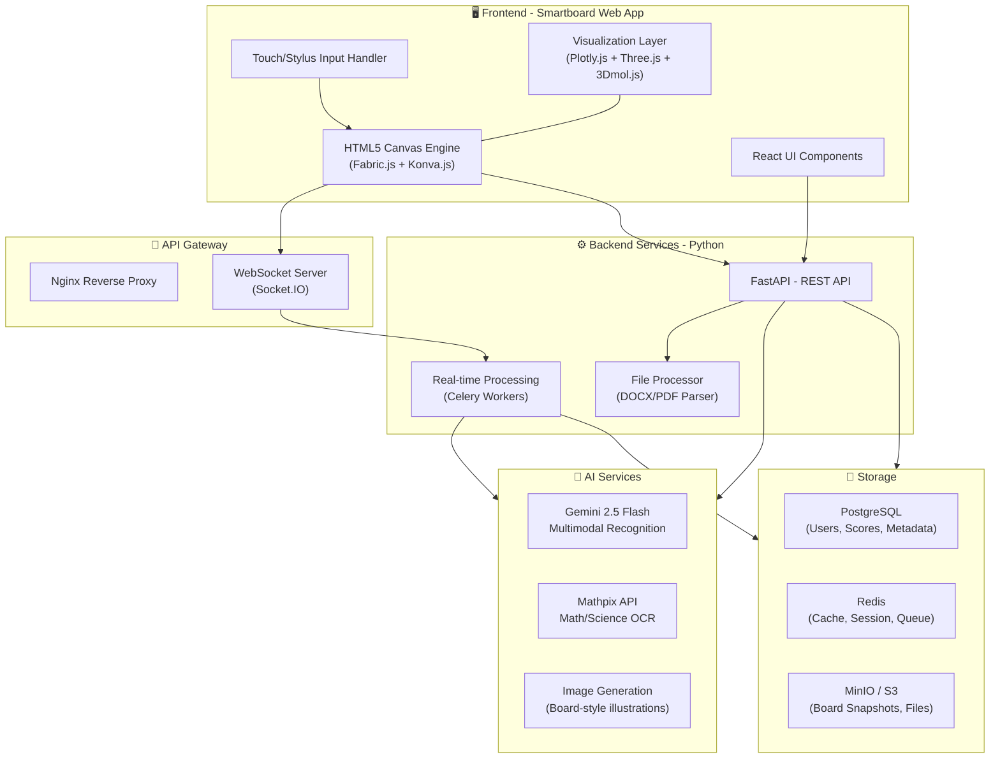
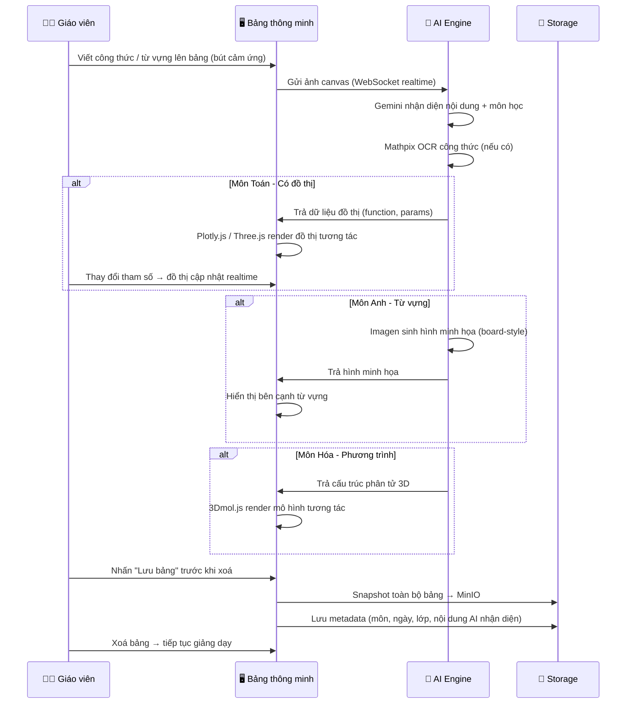
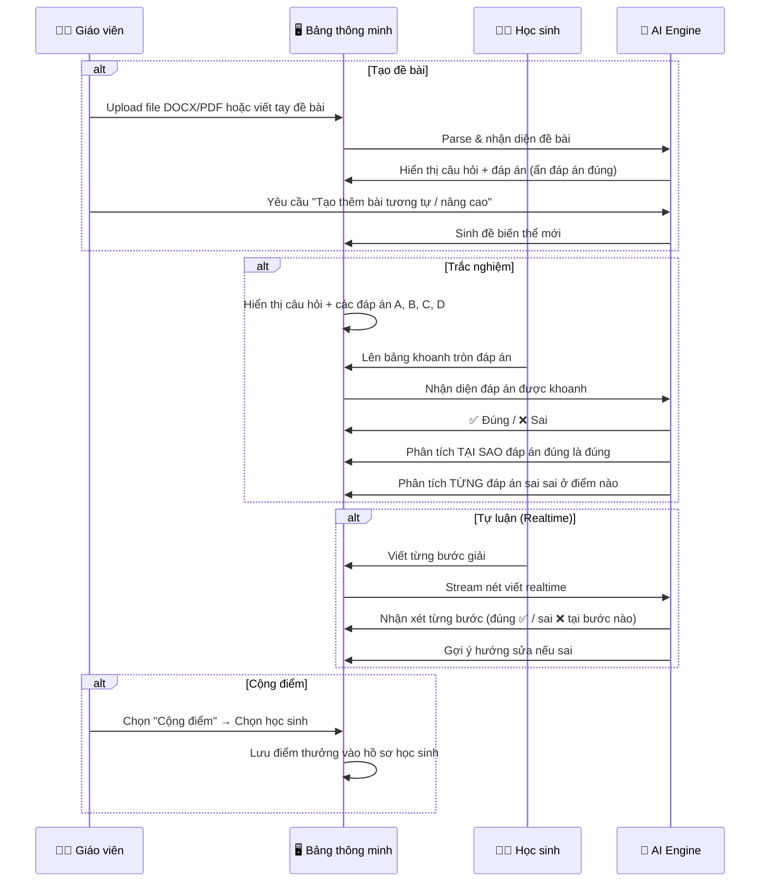

# 🎓 AI Interactive Canvas — Bảng Vẽ Thông Minh Hỗ Trợ Giảng Dạy

## Tổng Quan Dự Án

**AI Interactive Canvas** là sản phẩm phần mềm chạy trên **bảng thông minh cảm ứng (Interactive Smartboard)** trong trường học, hỗ trợ giáo viên giảng dạy và học sinh tương tác trực tiếp với bảng. AI nhận diện chữ viết tay, công thức, từ vựng trên bảng → tự động sinh hình minh họa, đồ thị tương tác 2D/3D, chấm bài theo thời gian thực, và giải thích chi tiết.

> [!IMPORTANT]
> Dự án phục vụ **đa môn học**: Toán, Vật lý, Hóa học, Tiếng Anh, và các môn khác. Không giới hạn chỉ ở Toán.

---

## Tổng Hợp Yêu Cầu

### 🖥️ Nền tảng & Thiết bị
| Hạng mục | Chi tiết |
|---|---|
| **Nền tảng** | Web App chạy trên trình duyệt bảng thông minh cảm ứng |
| **Thiết bị đầu vào** | Bút cảm ứng (stylus) + Chuột/Bàn phím |
| **Thiết bị mục tiêu chính** | Bảng thông minh cảm ứng trong giáo dục (ViewSonic, Samsung Flip, SMART Board, Promethean…) |

### 🤖 AI Core
| Tính năng | Mô tả |
|---|---|
| **Nhận diện chữ viết tay** | Đa ngôn ngữ (Tiếng Việt, Tiếng Anh), công thức Toán/Lý/Hóa |
| **Sinh hình minh họa** | Phong cách "chữ viết bảng", hình ảnh trọng tâm dễ hiểu |
| **Đồ thị tương tác** | 2D/3D, thay đổi số liệu → hình cập nhật realtime |
| **Chấm bài realtime** | Tự luận (chấm từng bước) + Trắc nghiệm (phân tích đáp án) |
| **Sinh đề bài** | Từ file upload (DOCX/PDF) hoặc giáo viên viết tay → AI sinh biến thể & nâng cao |

### 💾 Lưu trữ & Quản lý
| Tính năng | Mô tả |
|---|---|
| **Lưu bảng (Snapshot)** | Lưu ảnh toàn bộ bảng trước khi xoá, phân loại theo môn/ngày |
| **Xem lại** | Học sinh xem lại hình ảnh bảng theo môn học + ngày cụ thể |
| **Cộng điểm** | Giáo viên chọn học sinh → cộng điểm → lưu vào hệ thống (tính năng giai đoạn sau) |

---

## Kiến Trúc Hệ Thống



---

## Tech Stack Chi Tiết

### Frontend (Chạy trên trình duyệt Smartboard)

| Công nghệ | Mục đích | Lý do chọn |
|---|---|---|
| **TypeScript** | Ngôn ngữ chính | Mở rộng từ JavaScript (đã học), có type safety, giảm bug |
| **React 19 + Next.js 15** | UI Framework | Ecosystem lớn nhất, SSR cho tốc độ tải, cộng đồng hỗ trợ mạnh |
| **Fabric.js** | Canvas Engine chính | Hỗ trợ touch, stylus, vẽ tự do, quản lý objects trên canvas tốt nhất |
| **Konva.js** | Canvas phụ trợ | Layered canvas, tốt cho overlay annotations và UI elements |
| **Plotly.js** | Đồ thị 2D tương tác | Vẽ đồ thị hàm số, biểu đồ vật lý/hóa học, zoom/pan, thay đổi tham số |
| **Three.js** | Đồ thị 3D tương tác | Hình học không gian 3D, mô hình vật lý 3D, xoay/zoom |
| **3Dmol.js** | Hóa học 3D | Mô hình phân tử 3D tương tác (cho môn Hóa) |
| **KaTeX / MathJax** | Render công thức | Hiển thị công thức Toán/Lý/Hóa đẹp sau khi AI nhận diện |
| **Tailwind CSS** | Styling | Nhanh, responsive, dễ customize cho màn hình lớn (smartboard) |

### Backend

| Công nghệ | Mục đích | Lý do chọn |
|---|---|---|
| **Python 3.12+** | Ngôn ngữ backend chính | Đã học, ecosystem AI/ML tốt nhất, FastAPI performance cao |
| **FastAPI** | REST API Framework | Đã học, async native, auto-generate OpenAPI docs, type hints |
| **Socket.IO (python-socketio)** | WebSocket realtime | Chấm bài realtime, sync bảng vẽ |
| **Celery + Redis** | Task Queue | Xử lý AI nặng (nhận diện, sinh hình) không block main thread |
| **python-docx / pdfplumber** | File Processing | Parse đề bài từ DOCX/PDF upload |
| **Pillow / OpenCV** | Image Processing | Xử lý ảnh bảng trước khi gửi AI, snapshot bảng |

### AI Services

| Dịch vụ | Mục đích | Chi tiết |
|---|---|---|
| **Google Gemini 2.5 Flash** | Nhận diện đa phương thức chính | Nhận diện chữ viết tay, phân tích bài làm, sinh đề bài, giải thích đáp án. Multimodal (nhận ảnh canvas → trả text). Tốc độ nhanh, chi phí thấp. |
| **Mathpix API** | OCR chuyên biệt Toán/Khoa học | Nhận diện công thức toán, phương trình hóa học, ký hiệu vật lý với độ chính xác cao nhất thị trường. Trả về LaTeX. |
| **Google Imagen 4** | Sinh hình minh họa | Sinh hình ảnh minh họa từ vựng, khái niệm khoa học. Phong cách "vẽ bảng" hoặc hình minh họa giáo dục. |

> [!TIP]
> **Chiến lược AI kết hợp**: Gửi ảnh canvas → Gemini nhận diện tổng thể (ngữ cảnh, môn học, ý định) → Nếu có công thức Toán/Khoa học → chuyển tiếp qua Mathpix để OCR chính xác → Gemini tổng hợp kết quả cuối cùng.

### Database & Storage

| Công nghệ | Mục đích |
|---|---|
| **PostgreSQL 16** | Database chính: Users, Classes, Students, Scores, Subjects, Sessions |
| **Redis 7** | Cache AI responses, session management, Celery message broker |
| **MinIO** (Self-hosted S3) | Lưu board snapshots (ảnh PNG/WebP), file upload (DOCX/PDF) |

### DevOps & Deployment

| Công nghệ | Mục đích |
|---|---|
| **Docker + Docker Compose** | Container hóa toàn bộ services, dễ deploy |
| **Nginx** | Reverse proxy, load balancing, serve static files |
| **GitHub Actions** | CI/CD pipeline |
| **Prometheus + Grafana** | Monitoring (giai đoạn sau) |

---

## Ngôn Ngữ & Framework Bổ Sung (So với chương trình học)

Dựa trên chương trình bạn đã học tại Rikkei, đây là các công nghệ **mới bổ sung** và lý do:

| Đã học | Bổ sung mới | Lý do |
|---|---|---|
| JavaScript | **TypeScript** | Superset của JS, thêm type safety, bắt buộc cho dự án quy mô lớn |
| HTML/CSS | **Tailwind CSS** | Utility-first CSS framework, tăng tốc styling 3-5x |
| Python + FastAPI | **Celery** | Async task queue cho xử lý AI nặng, pattern phổ biến trong production |
| Database (SQL) | **PostgreSQL + Redis** | PG là DB production-grade, Redis cho cache/queue |
| _(chưa có)_ | **Docker** | Container hóa, chuẩn công nghiệp, deployment nhất quán |
| _(chưa có)_ | **React + Next.js** | Frontend framework phổ biến nhất, mạnh mẽ nhất hiện tại |
| _(chưa có)_ | **Socket.IO** | Real-time communication chuẩn, dễ học |
| Agile/Scrum | **GitHub Projects** | Quản lý sprint/task trực tiếp trên GitHub |

> [!NOTE]
> Tất cả công nghệ bổ sung đều có **cộng đồng lớn, tài liệu phong phú, learning curve hợp lý** — phù hợp để học trong quá trình làm dự án thực tập.

---

## Cơ Sở Dữ Liệu — Sơ Đồ ER

```mermaid
erDiagram
    TEACHER ||--o{ CLASS : manages
    TEACHER ||--o{ QUIZ : creates
    TEACHER ||--o{ BOARD_SESSION : conducts

    CLASS ||--o{ STUDENT : contains
    CLASS ||--o{ SUBJECT : studies

    BOARD_SESSION ||--|| SUBJECT : belongs_to
    BOARD_SESSION ||--o{ BOARD_SNAPSHOT : has
    BOARD_SESSION ||--o{ QUIZ_SESSION : includes

    QUIZ ||--o{ QUESTION : contains
    QUESTION ||--o{ ANSWER_OPTION : has

    QUIZ_SESSION ||--|| QUIZ : uses
    QUIZ_SESSION ||--o{ STUDENT_ANSWER : receives

    STUDENT_ANSWER ||--|| STUDENT : submitted_by
    STUDENT_ANSWER ||--|| QUESTION : answers
    STUDENT_ANSWER }o--|| ANSWER_OPTION : selects

    STUDENT ||--o{ SCORE_RECORD : earns

    TEACHER {
        uuid id PK
        string name
        string email
        string password_hash
    }

    CLASS {
        uuid id PK
        string name
        string grade_level
        uuid teacher_id FK
    }

    STUDENT {
        uuid id PK
        string name
        string student_code
        uuid class_id FK
    }

    SUBJECT {
        uuid id PK
        string name
        string category
    }

    BOARD_SESSION {
        uuid id PK
        uuid teacher_id FK
        uuid class_id FK
        uuid subject_id FK
        timestamp started_at
        timestamp ended_at
    }

    BOARD_SNAPSHOT {
        uuid id PK
        uuid session_id FK
        string image_url
        text ai_transcription
        timestamp captured_at
        int page_number
    }

    QUIZ {
        uuid id PK
        uuid teacher_id FK
        uuid subject_id FK
        string title
        string difficulty
        string source_type
        string source_file_url
    }

    QUESTION {
        uuid id PK
        uuid quiz_id FK
        text content
        string question_type
        text correct_answer
        text explanation
        boolean ai_generated
    }

    ANSWER_OPTION {
        uuid id PK
        uuid question_id FK
        string label
        text content
        boolean is_correct
        text wrong_explanation
    }

    STUDENT_ANSWER {
        uuid id PK
        uuid quiz_session_id FK
        uuid student_id FK
        uuid question_id FK
        uuid selected_option_id FK
        text written_answer
        text ai_feedback
        float score
        timestamp submitted_at
    }

    SCORE_RECORD {
        uuid id PK
        uuid student_id FK
        uuid session_id FK
        float bonus_points
        string reason
        timestamp awarded_at
    }

    QUIZ_SESSION {
        uuid id PK
        uuid session_id FK
        uuid quiz_id FK
        string status
        timestamp started_at
    }
```

---

## Luồng Hoạt Động Chính

### 1. Luồng Giảng Dạy (Teaching Flow)



### 2. Luồng Làm Bài & Chấm Điểm (Quiz & Grading Flow)



---

## Phân Chia Module & Cấu Trúc Thư Mục

```
ai-interactive-canvas/
├── 📁 frontend/                    # Next.js + React + TypeScript
│   ├── src/
│   │   ├── app/                    # Next.js App Router
│   │   ├── components/
│   │   │   ├── canvas/             # Canvas engine (Fabric.js wrapper)
│   │   │   ├── visualization/      # Plotly, Three.js, 3Dmol components
│   │   │   ├── quiz/               # Quiz UI (MCQ, essay)
│   │   │   ├── board/              # Board management (save, clear, history)
│   │   │   └── ui/                 # Shared UI components
│   │   ├── hooks/                  # Custom React hooks
│   │   ├── services/               # API client, WebSocket client
│   │   ├── stores/                 # State management (Zustand)
│   │   └── types/                  # TypeScript type definitions
│   └── public/
│
├── 📁 backend/                     # Python FastAPI
│   ├── app/
│   │   ├── api/
│   │   │   ├── routes/
│   │   │   │   ├── canvas.py       # Canvas recognition endpoints
│   │   │   │   ├── quiz.py         # Quiz CRUD & grading
│   │   │   │   ├── board.py        # Board session & snapshots
│   │   │   │   ├── student.py      # Student management & scores
│   │   │   │   └── file_upload.py  # DOCX/PDF upload & parse
│   │   │   └── websocket.py        # WebSocket handlers
│   │   ├── services/
│   │   │   ├── ai_recognition.py   # Gemini + Mathpix integration
│   │   │   ├── image_gen.py        # Imagen illustration generation
│   │   │   ├── quiz_generator.py   # AI quiz generation & variation
│   │   │   ├── grading.py          # Real-time grading engine
│   │   │   └── file_parser.py      # DOCX/PDF parsing
│   │   ├── models/                 # SQLAlchemy ORM models
│   │   ├── schemas/                # Pydantic request/response schemas
│   │   ├── core/                   # Config, security, database
│   │   └── tasks/                  # Celery async tasks
│   ├── alembic/                    # Database migrations
│   └── tests/
│
├── 📁 docker/
│   ├── docker-compose.yml
│   ├── Dockerfile.frontend
│   ├── Dockerfile.backend
│   └── nginx.conf
│
├── 📁 docs/                        # Project documentation
├── .github/workflows/              # CI/CD
└── README.md
```

---

## Lộ Trình Phát Triển (Roadmap)

### 🏁 Phase 1 — MVP Core (Tuần 1–4)
> Mục tiêu: Canvas cơ bản + AI nhận diện + Đồ thị đơn giản

- [ ] Setup project: Next.js frontend + FastAPI backend + Docker
- [ ] Canvas engine: Vẽ tự do bằng bút cảm ứng / chuột (Fabric.js)
- [ ] Tích hợp Gemini 2.5 Flash: Gửi ảnh canvas → nhận diện nội dung
- [ ] Tích hợp Mathpix: OCR công thức toán/khoa học
- [ ] Render công thức đẹp (KaTeX) sau khi nhận diện
- [ ] Đồ thị 2D cơ bản (Plotly.js): Nhận hàm số → vẽ đồ thị tương tác
- [ ] Database setup: PostgreSQL + SQLAlchemy models cơ bản

### 📊 Phase 2 — Visualization & Quiz (Tuần 5–8)
> Mục tiêu: Đồ thị 3D + Hình minh họa + Hệ thống bài tập

- [ ] Đồ thị 3D (Three.js): Hình học không gian, mô hình vật lý
- [ ] Mô hình phân tử 3D (3Dmol.js) cho Hóa học
- [ ] Sinh hình minh họa (Imagen): Từ vựng tiếng Anh, khái niệm khoa học
- [ ] Upload DOCX/PDF → Parse đề bài → Hiển thị câu hỏi
- [ ] CRUD Quiz: Giáo viên tạo/sửa câu hỏi trắc nghiệm + tự luận
- [ ] AI sinh đề bài biến thể / nâng cao từ mẫu

### ✅ Phase 3 — Real-time Grading (Tuần 9–12)
> Mục tiêu: Chấm bài realtime + Phân tích đáp án

- [ ] WebSocket pipeline: Stream nét viết → AI phân tích realtime
- [ ] Chấm trắc nghiệm: Nhận diện khoanh tròn → Đúng/Sai → Giải thích
- [ ] Chấm tự luận realtime: Phân tích từng bước giải → Feedback tức thì
- [ ] UI hiển thị kết quả chấm (animation, highlight đúng/sai)

### 💾 Phase 4 — Board Management & Polish (Tuần 13–16)
> Mục tiêu: Lưu bảng, xem lại, cộng điểm, hoàn thiện UX

- [ ] Snapshot bảng: Lưu ảnh toàn bộ bảng trước khi xoá
- [ ] Phân loại snapshot theo môn học + ngày + lớp
- [ ] Giao diện xem lại bảng cũ (gallery view)
- [ ] Hệ thống cộng điểm: Chọn học sinh → Cộng/trừ → Lưu lịch sử
- [ ] Quản lý lớp học, danh sách học sinh cơ bản
- [ ] Tối ưu UX cho màn hình lớn (smartboard)
- [ ] Testing, bug fixes, documentation

---

## Ước Tính API Costs (Tham khảo)

| Dịch vụ | Giá ước tính | Ghi chú |
|---|---|---|
| **Gemini 2.5 Flash** | ~\$0.15 / 1M input tokens | Rất rẻ, phù hợp dự án giáo dục |
| **Mathpix** | Free 1000 requests/tháng | Đủ cho giai đoạn dev & demo |
| **Imagen 4** | ~\$0.02 / ảnh | Chỉ sinh khi cần minh họa |

> [!TIP]
> Tổng chi phí AI ước tính cho giai đoạn phát triển + demo: **< \$20/tháng**. Rất phù hợp cho dự án thực tập.

---

## Câu Hỏi Cần Làm Rõ Thêm

> Những câu hỏi này sẽ giúp tôi tinh chỉnh kiến trúc và bắt đầu code:

1. **Quy mô team**: Dự án có bao nhiêu thành viên? Ai phụ trách Frontend, ai phụ trách Backend?
2. **Thời hạn**: Tổng thời gian thực tập là bao lâu? (4 tháng / 6 tháng / khác?)
3. **Bảng thông minh cụ thể**: Trường/công ty có sẵn bảng thông minh nào để test không? (Nếu chưa có, giai đoạn dev có thể test trên tablet hoặc màn hình cảm ứng)
4. **Hosting**: Deploy ở đâu? Server trường, máy chủ công ty Rikkei, hay cloud (Google Cloud / AWS)?
5. **Bạn muốn bắt đầu code từ phần nào trước?**
