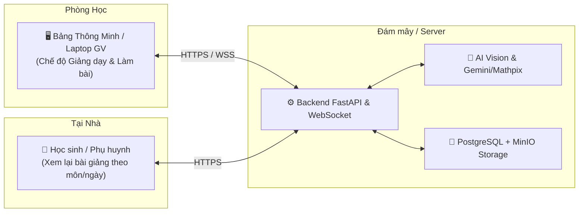
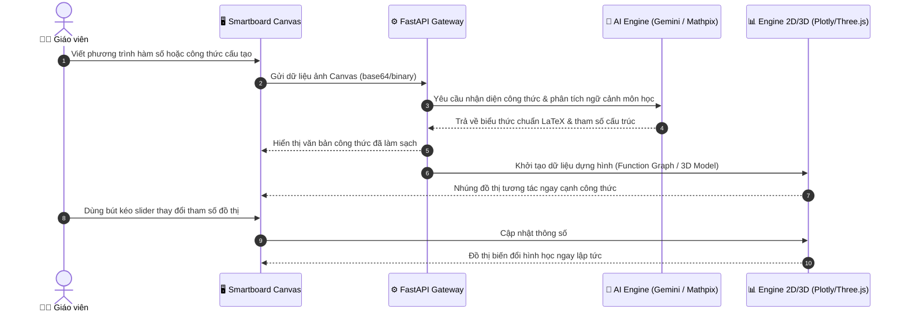
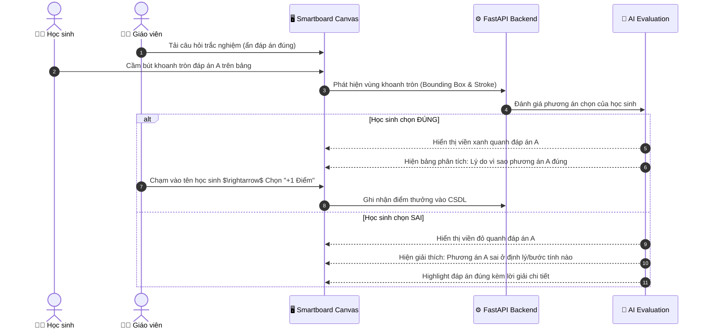
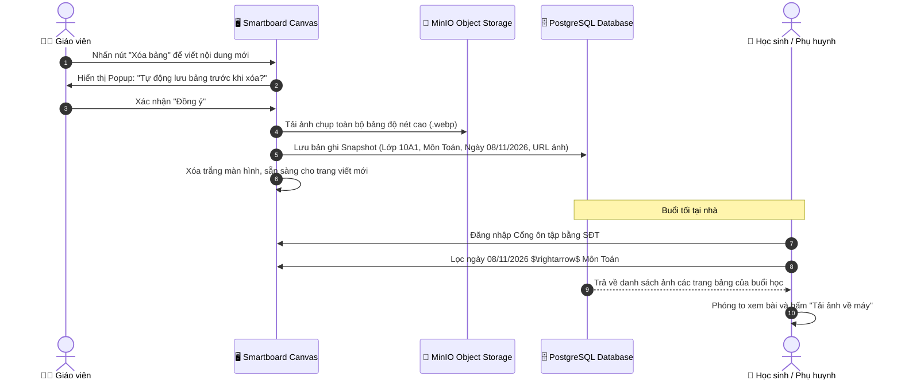

# TÀI LIỆU ĐẶC TẢ YÊU CẦU PHẦN MỀM (SRS)
## DỰ ÁN: BẢNG VẼ THÔNG MINH HỖ TRỢ GIẢNG DẠY (AI INTERACTIVE CANVAS)
**Tiêu chuẩn áp dụng:** IEEE 830-1998 / ISO/IEC/IEEE 29148  
**Phiên bản:** 1.0 - Bản hoàn chỉnh  
**Ngày lập:** 08/11/2026  
**Đơn vị thực hiện:** Nhóm Thực tập Rikkei Academy (3 thành viên)  
**Thời gian phát triển:** 01 Tháng  

---

## MỤC LỤC
1. [GIỚI THIỆU (INTRODUCTION)](#1-giới-thiệu-introduction)
   - 1.1 Mục đích tài liệu
   - 1.2 Phạm vi dự án
   - 1.3 Định nghĩa và thuật ngữ viết tắt
   - 1.4 Tài liệu tham khảo
2. [MÔ TẢ TỔNG QUAN (OVERALL DESCRIPTION)](#2-mô-tả-tổng-quan-overall-description)
   - 2.1 Bối cảnh và mô hình triển khai
   - 2.2 Các nhóm tác nhân (User Classes & Actors)
   - 2.3 Môi trường vận hành & Phần cứng tương thích
   - 2.4 Ràng buộc thiết kế và hiện thực
   - 2.5 Giả định và phụ thuộc
3. [YÊU CẦU CHỨC NĂNG (FUNCTIONAL REQUIREMENTS)](#3-yêu-cầu-chức-năng-functional-requirements)
   - 3.1 Module Xác thực & Phân quyền (Authentication & Authorization)
   - 3.2 Module Bảng vẽ tương tác (Interactive Canvas Engine)
   - 3.3 Module AI Nhận diện & Cơ chế Tự hiệu chỉnh (AI Multimodal & Correction)
   - 3.4 Module Trực quan hóa dữ liệu 2D/3D & Minh họa (Visualization & Graphics)
   - 3.5 Module Quản lý Đề bài & Sinh câu hỏi AI (Quiz & AI Question Generator)
   - 3.6 Module Chấm bài & Phân tích đáp án (Real-time & MCQ Grading Engine)
   - 3.7 Module Quản lý Phiên học & Lưu trữ Snapshot (Session & Snapshot Management)
   - 3.8 Module Điểm thưởng & Tương tác lớp học (Gamification & Score Bonus)
4. [YÊU CẦU PHI CHỨC NĂNG (NON-FUNCTIONAL REQUIREMENTS)](#4-yêu-cầu-phi-chức-năng-non-functional-requirements)
   - 4.1 Hiệu năng (Performance Requirements)
   - 4.2 Tính sẵn sàng & Chế độ Offline (Availability & Fault Tolerance)
   - 4.3 Tính bảo mật (Security Requirements)
   - 4.4 Khả năng sử dụng & Trải nghiệm Smartboard (Usability)
   - 4.5 Khả năng mở rộng & Cô lập lớp học (Concurrency & Multi-tenancy)
5. [CÁC USE CASE TRỌNG TÂM (CORE USE CASES)](#5-các-use-case-trọng-tâm-core-use-cases)
6. [PHÂN LOẠI ƯU TIÊN (MOSCOW) & KẾ HOẠCH TRIỂN KHAI 1 THÁNG](#6-phân-loại-ưu-tiên-moscow--kế-hoạch-triển-khai-1-tháng)

---

## 1. GIỚI THIỆU (INTRODUCTION)

### 1.1 Mục đích tài liệu
Tài liệu này đặc tả chi tiết toàn bộ yêu cầu chức năng (Functional Requirements) và yêu cầu phi chức năng (Non-Functional Requirements) cho hệ thống **AI Interactive Canvas** (Bảng vẽ tương tác thông minh hỗ trợ giảng dạy). Tài liệu đóng vai trò là kim chỉ nam pháp lý và kỹ thuật cho nhóm phát triển (3 thành viên), giáo viên hướng dẫn và các bên liên quan trong suốt kỳ thực tập 1 tháng.

### 1.2 Phạm vi dự án
- **Tên sản phẩm:** AI Interactive Canvas (Bảng vẽ thông minh AI).
- **Mục tiêu:** Xây dựng một ứng dụng bảng vẽ web tương tác cao, tối ưu cho màn hình cảm ứng của các loại bảng thông minh (Smartboard) và thiết bị di động/máy tính trong lớp học. Ứng dụng tích hợp AI đa phương thức để:
  - Nhận diện nét vẽ tay, công thức khoa học, chữ viết đa ngôn ngữ.
  - Tự động dựng mô hình tương tác 2D/3D (đồ thị hàm số, hình học không gian, mô hình phân tử hóa học) và tạo hình minh họa ngữ cảnh.
  - Hỗ trợ làm bài trắc nghiệm/tự luận trực tiếp trên bảng, chấm điểm và giải thích chi tiết theo thời gian thực.
  - Lưu trữ ảnh bảng học theo ngày/môn để học sinh và phụ huynh xem lại tại nhà, khắc phục triệt để tình trạng xóa bảng mất kiến thức.
- **Phạm vi môn học:** Thiết kế tổng quát hỗ trợ Toán học, Vật lý, Tiếng Anh, Hóa học, Sinh học... cho mọi cấp học (Tiểu học, THCS, THPT).

### 1.3 Định nghĩa và thuật ngữ viết tắt
- **Smartboard:** Bảng tương tác thông minh cảm ứng cỡ lớn lắp tại phòng học (ViewSonic, Samsung Flip, SMART Board, Promethean...).
- **Canvas:** Không gian vẽ kỹ thuật số trên giao diện web.
- **Multimodal AI:** Mô hình trí tuệ nhân tạo có khả năng tiếp nhận và xử lý đồng thời dữ liệu thị giác (hình ảnh nét vẽ) và văn bản (Prompt).
- **OCR (Optical Character Recognition):** Công nghệ nhận dạng ký tự quang học.
- **LaTeX:** Hệ thống chuẩn soạn thảo văn bản toán học và khoa học kỹ thuật.
- **Snapshot:** Ảnh chụp nguyên trạng toàn bộ nội dung của bảng vẽ tại một thời điểm.
- **OTP (One-Time Password):** Mật khẩu sử dụng một lần để xác thực đăng nhập.
- **MoSCoW:** Phương pháp phân loại ưu tiên yêu cầu (Must have, Should have, Could have, Won't have).

---

## 2. MÔ TẢ TỔNG QUAN (OVERALL DESCRIPTION)

### 2.1 Bối cảnh và mô hình triển khai
Hệ thống là giải pháp **Web App tương thích đa nền tảng** hoạt động theo mô hình Client-Server. 
- **Tại lớp học:** Bảng thông minh chạy trình duyệt web (hoặc kết nối qua máy tính giáo viên) tải giao diện Bảng vẽ chính.
- **Tại nhà:** Học sinh hoặc phụ huynh truy cập cổng xem lại bài giảng (Portal) bằng điện thoại, tablet hoặc máy tính để ôn bài.



### 2.2 Các nhóm tác nhân (User Classes & Actors)
1. **Giáo viên (Teacher):**
   - Đăng nhập bằng Email và Số điện thoại (xác thực OTP qua email).
   - Khởi tạo tiết dạy, chọn môn học, khối lớp.
   - Viết, vẽ, giảng bài; ra lệnh cho AI dựng đồ thị, sinh hình vẽ.
   - Tải đề bài (DOCX/PDF) hoặc viết đề trực tiếp; yêu cầu AI sinh bài tập mở rộng.
   - Điều khiển chấm bài của học sinh; cộng điểm khuyến khích.
   - Thao tác lưu Snapshot bảng học trước khi xóa bảng.
2. **Học sinh (Student) & Phụ huynh (Parent):**
   - Học sinh trung học: Đăng nhập bằng SĐT cá nhân.
   - Học sinh tiểu học: Phụ huynh đăng nhập bằng SĐT phụ huynh để quản lý việc học của con.
   - Quyền hạn: **Chỉ xem (Read-only)**, tìm kiếm bài giảng theo môn học/ngày tháng, tải ảnh bảng về máy.
   - Tại lớp học: Trực tiếp lên bảng tương tác làm bài (không cần đăng nhập tài khoản học sinh trên bảng).
3. **Quản trị viên hệ thống (Admin):**
   - Quản lý danh mục trường, lớp, tài khoản giáo viên, theo dõi tài nguyên AI.

### 2.3 Môi trường vận hành & Phần cứng tương thích
- **Thiết bị tại lớp:**
  - Bảng thông minh chạy Android (tích hợp trình duyệt Chromium).
  - Máy tính Windows / macOS kết nối cáp HDMI/Type-C và Touch-USB lên màn hình tương tác.
  - Máy tính bảng (iPad, Android Tablet) dùng cho giai đoạn thử nghiệm (PoC/Dev).
- **Thiết bị tại nhà:** Mọi trình duyệt web hiện đại (Chrome, Safari, Edge, Firefox) trên iOS, Android, PC.
- **Hệ thống Backend:** Linux/Windows Server, chạy Docker container hóa, Python 3.11+, PostgreSQL 16+, Redis 7+.

### 2.4 Ràng buộc thiết kế và hiện thực (Design & Implementation Constraints)
- **Ràng buộc thời gian:** Thời hạn phát triển trong **01 tháng** (4 tuần) của kỳ thực tập.
- **Ràng buộc nhân lực:** Team gồm **03 thành viên** (1 Leader, 2 Developers) với kiến thức nền tảng: Python, FastAPI, JavaScript, SQL. Cần ưu tiên các công nghệ có tính tương thích cao, giảm thiểu boilerplate.
- **Ràng buộc chi phí API:** Sử dụng API có chi phí tiết kiệm (Gemini 2.5 Flash, hạn ngạch miễn phí Mathpix/Cloudinary/MinIO).

### 2.5 Giả định và phụ thuộc
- Bảng thông minh trong lớp học có kết nối Internet ổn định trong giờ học.
- Bảng cảm ứng hỗ trợ tương tác đa điểm hoặc bút cảm ứng (stylus) tương thích với chuẩn W3C Touch Events / Pointer Events.

---

## 3. YÊU CẦU CHỨC NĂNG (FUNCTIONAL REQUIREMENTS)

### 3.1 Module Xác thực & Phân quyền (Authentication & Authorization)
- **FR-AUTH-01: Đăng nhập Giáo viên qua Email + SĐT + OTP**
  - Giáo viên nhập Email và Số điện thoại hợp lệ.
  - Hệ thống gửi mã OTP 6 chữ số qua Email để xác minh danh tính.
  - Giáo viên có quyền chọn *"Ghi nhớ đăng nhập trên thiết bị này"*.
- **FR-AUTH-02: Duy trì phiên đăng nhập 14 ngày (2 tuần)**
  - Sau khi xác thực thành công, phiên đăng nhập (JWT token kèm Refresh token an toàn) được lưu giữ trong 14 ngày.
  - Sau 14 ngày, hệ thống yêu cầu xác thực lại mã OTP để bảo vệ tài khoản phòng học.
- **FR-AUTH-03: Đăng ký & Đăng nhập Học sinh / Phụ huynh**
  - Cấp THCS & THPT: Đăng ký/đăng nhập bằng SĐT của học sinh.
  - Cấp Tiểu học: Đăng ký/đăng nhập bằng SĐT của phụ huynh.
  - Quy tắc: Mỗi học sinh chỉ gắn liền với đúng **01 tài khoản định danh duy nhất**.
- **FR-AUTH-04: Khôi phục mật khẩu đa kênh**
  - Cho phép người dùng lấy lại quyền truy cập qua mã OTP gửi về SMS hoặc Email đã đăng ký.
- **FR-AUTH-05: Phân quyền dữ liệu (Role-Based Access)**
  - Giáo viên: Toàn quyền tạo phiên học, thao tác bảng, lưu snapshot, chấm bài, cộng điểm.
  - Học sinh/Phụ huynh: Chỉ có quyền đọc (Read-only) các bài học thuộc lớp mình theo học.

---

### 3.2 Module Bảng vẽ tương tác (Interactive Canvas Engine)
- **FR-CAN-01: Nhận diện đầu vào kép (Dual-Input Support)**
  - Nhận diện mượt mà nét vẽ bằng **Bút cảm ứng (Stylus)** (hỗ trợ lực nhấn nếu thiết bị có) và ngón tay cảm ứng.
  - Hỗ trợ thao tác bằng **Chuột & Bàn phím** (click vẽ, gõ text box, phím tắt xóa/hoàn tác).
- **FR-CAN-02: Công cụ vẽ cơ bản**
  - Bút viết (Pen) với nhiều nét thanh đậm và bảng màu sắc chuyên biệt cho bảng đen/bảng trắng.
  - Bút dạ quang (Highlighter), Tẩy nét vẽ (Stroke Eraser) và Tẩy vùng (Area Eraser).
  - Thước kẻ ảo, công cụ vẽ hình học phẳng cơ bản (tam giác, hình tròn, elip, đường thẳng).
- **FR-CAN-03: Phân trang & Quản lý bảng vô hạn**
  - Hỗ trợ thêm bảng mới (Next Page), chuyển trang linh hoạt (Prev/Next Page) mà không làm mất nội dung bảng trước.
  - Nút "Xóa toàn bộ bảng" (Clear Board) có cơ chế **bắt buộc cảnh báo lưu snapshot**.

---

### 3.3 Module AI Nhận diện & Cơ chế Tự hiệu chỉnh (AI Multimodal & Correction)
- **FR-AI-01: Nhận diện chữ viết tay & ký hiệu đa môn**
  - **Toán học:** Nhận diện phương trình, bất đẳng thức, tích phân, ma trận, hình học và chuyển đổi sang định dạng LaTeX chuẩn.
  - **Vật lý:** Nhận diện sơ đồ mạch điện, vector lực, công thức dao động, sóng ánh sáng.
  - **Hóa học:** Nhận diện phương trình phản ứng hóa học (cân bằng chất, trạng thái kết tủa/bay hơi), công thức cấu tạo phân tử hữu cơ.
  - **Tiếng Anh & Ngôn ngữ:** Nhận diện chữ viết tay từ vựng, ngữ pháp tiếng Anh, tiếng Việt có dấu.
- **FR-AI-02: Cơ chế suy luận ngữ cảnh & Gợi ý sửa lỗi (Contextual Reasoning & Ambiguity Correction)**
  - Khi chữ viết của người dùng bị méo hoặc không rõ nét (ví dụ: chữ `sin` dễ nhầm thành `sim`, dấu cộng nhầm thành chữ t):
    - AI sử dụng ngữ cảnh môn học hiện tại để suy luận logic tốt nhất.
    - Nếu độ tin cậy (Confidence Score) dưới 85%, AI sẽ khoanh vùng vị trí đó trên bảng với viền chấm cảnh báo.
    - Hệ thống mở ra popup gợi ý các ký tự có thể xảy ra (ví dụ: `[sin | sim | sum]`).
    - Giáo viên hoặc học sinh chỉ cần chạm nhẹ vào đáp án đúng để AI lập tức cập nhật lại toàn bộ mạch phân tích.
- **FR-AI-03: Chuyển đổi định dạng trực tiếp (Handwriting to Clean Math/Text)**
  - Hỗ trợ nút chuyển đổi nhanh một vùng nét chữ viết tay thành văn bản chuẩn in hoa/LaTeX rõ nét ngay trên vị trí bảng.

---

### 3.4 Module Trực quan hóa dữ liệu 2D/3D & Minh họa (Visualization & Graphics)
- **FR-VIZ-01: Đồ thị hàm số 2D tương tác thời gian thực**
  - Tự động vẽ đồ thị tương tác từ phương trình viết tay (hàm bậc 1, bậc 2, bậc 3, lượng giác...).
  - Cho phép người dùng chạm kéo thanh trượt (slider) thay đổi hệ số $(a, b, c)$ $\rightarrow$ hình dạng đồ thị co giãn, dịch chuyển trực tiếp tương ứng.
- **FR-VIZ-02: Mô hình hình học không gian 3D tương tác**
  - Tự động dựng hình chóp, hình lăng trụ, mặt cầu, hình nón từ mô tả bài toán.
  - Hỗ trợ dùng tay/bút để xoay 360 độ quanh các trục không gian, zoom to/nhỏ để học sinh dễ dàng quan sát góc khuất, thiết diện.
- **FR-VIZ-03: Mô hình phân tử Hóa học 3D (3D Molecular Viewer)**
  - Khi viết công thức phân tử (ví dụ: $H_2O$, $CH_4$, $C_6H_6$), hệ thống dựng mô hình quả cầu - que nối 3D của phân tử, cho phép xoay và xem góc liên kết.
- **FR-VIZ-04: Sinh hình ảnh minh họa từ vựng & khái niệm (Board-Style Illustrations)**
  - Với môn Tiếng Anh hoặc Sinh học/Địa lý: Viết từ vựng (ví dụ: *"Photosynthesis"*, *"Solar System"*, *"Volcano"*) $\rightarrow$ AI sinh ảnh minh họa trọng tâm, phong cách vẽ phấn trắng hoặc nét phác thảo giáo dục, đặt cạnh từ vựng.

---

### 3.5 Module Quản lý Đề bài & Sinh câu hỏi AI (Quiz & AI Question Generator)
- **FR-QUIZ-01: Nhập đề linh hoạt**
  - Giáo viên có thể viết trực tiếp câu hỏi và các đáp án lên bảng.
  - Giáo viên có thể tải lên tệp tin tài liệu (`.docx` hoặc `.pdf`). Hệ thống tự động bóc tách các câu hỏi và dàn trang lên bảng vẽ.
- **FR-QUIZ-02: Cơ chế ẩn đáp án phục vụ giảng dạy**
  - Khi hiển thị đề bài lên bảng, AI tự động nhận diện và ẩn toàn bộ đáp án đúng để học sinh suy nghĩ làm bài.
- **FR-QUIZ-03: AI sinh đề bài tương tự & nâng cao**
  - Từ câu hỏi đang hiển thị, giáo viên có thể bấm *"Tạo câu hỏi tương tự"* hoặc *"Nâng cao độ khó"*.
  - AI phân tích cấu trúc bài gốc, thay đổi thông số hoặc thêm điều kiện tư duy logic để tạo ra bài toán mới ngay trên bảng.

---

### 3.6 Module Chấm bài & Phân tích đáp án (Real-time & MCQ Grading Engine)
- **FR-GRADE-01: Chấm bài trắc nghiệm tương tác trên bảng**
  - Học sinh cầm bút khoanh tròn vào đáp án lựa chọn (A, B, C hoặc D).
  - AI nhận diện vùng khoanh và đánh giá kết quả:
    - Nếu đúng: Hiển thị hiệu ứng tích xanh ✅ kèm phân tích **tại sao đáp án này đúng**.
    - Nếu sai: Hiển thị cảnh báo ❌, chỉ rõ **lỗi sai của từng phương án gây nhiễu** (Distractors) để học sinh hiểu cặn kẽ vì sao mình nhầm lẫn.
- **FR-GRADE-02: Chấm bài tự luận theo thời gian thực (Real-time Step-by-Step Grading)**
  - Học sinh viết từng bước giải tự luận trên bảng.
  - AI phân tích ngữ nghĩa logic qua từng dòng:
    - Đánh dấu tích xanh tại các bước giải toán/lý đúng.
    - Phát hiện bước xảy ra lỗi logic hoặc sai số tính toán, gạch chân đỏ bước sai và đưa ra gợi ý hướng giải quyết mà không làm lộ ngay đáp án cuối cùng.

---

### 3.7 Module Quản lý Phiên học & Lưu trữ Snapshot (Session & Snapshot Management)
- **FR-SNAP-01: Lưu trữ Snapshot chủ động trước khi xóa bảng**
  - Khi bảng kín chữ và giáo viên bấm nút "Xóa bảng" hoặc bấm "Lưu bài học", hệ thống tự động ghi lại toàn bộ hình ảnh độ phân giải cao của bảng.
  - Ảnh được gắn thẻ (Tags) tự động: Tên giáo viên, Tên lớp, Môn học, Ngày giờ, Tiết học.
  - Toàn bộ nội dung chữ/công thức viết tay được AI OCR thành metadata văn bản phục vụ tìm kiếm.
- **FR-SNAP-02: Cổng ôn tập dành cho Học sinh & Phụ huynh (Portal Review)**
  - Giao diện dạng Lịch học (Calendar) hoặc Bộ sưu tập (Gallery).
  - Học sinh chọn Ngày học $\rightarrow$ Chọn Môn học $\rightarrow$ Xem toàn bộ các trang bảng đã giảng dạy trong buổi hôm đó.
  - Hỗ trợ phóng to, xem chi tiết và **Tải ảnh chất lượng gốc (Download High-Res PNG/WebP)** về máy.
- **FR-SNAP-03: Thời hạn lưu trữ dữ liệu 06 tháng**
  - Mọi ảnh chụp snapshot bảng và dữ liệu liên quan được lưu trữ tối thiểu **06 tháng** kể từ ngày lưu trên hệ sinh thái đám mây/MinIO.

---

### 3.8 Module Điểm thưởng & Tương tác lớp học (Gamification & Score Bonus)
- **FR-SCORE-01: Danh sách học sinh theo lớp**
  - Giáo viên chọn Lớp học $\rightarrow$ Hệ thống hiển thị thanh danh sách học sinh của lớp cạnh bảng vẽ.
- **FR-SCORE-02: Cơ chế cộng điểm tương tác**
  - Khi học sinh A được gọi lên bảng hoàn thành bài tập tốt, giáo viên chạm vào tên học sinh A và chọn *"Cộng điểm (+1, +2...)"*.
  - Điểm thưởng và lịch sử cộng điểm được ghi nhận vào cơ sở dữ liệu cùng với snapshot bài làm của học sinh đó.

---

## 4. YÊU CẦU PHI CHỨC NĂNG (NON-FUNCTIONAL REQUIREMENTS)

### 4.1 Hiệu năng (Performance Requirements)
- **NFR-PERF-01 (Thời gian nhận diện AI):** Sau khi giáo viên hoặc học sinh dừng nét viết (sau debounce 800ms) hoặc bấm nút nhận diện:
  - Thời gian xử lý nhận diện và phản hồi đồ thị/LaTeX thông thường: **$\le 2.0$ giây**.
  - Trong điều kiện mạng chậm hoặc công thức phức tạp: **tối đa không quá 5.0 giây**.
- **NFR-PERF-02 (Độ trễ vẽ Canvas):** Tốc độ phản hồi nét bút vẽ (Stylus input latency) trên màn hình cảm ứng: **$\le 16ms$** (đáp ứng tốc độ khung hình 60 FPS mượt mà không có độ trễ giật nét).
- **NFR-PERF-03 (Thời gian tải Snapshot):** Thời gian tải và hiển thị danh mục ảnh bài giảng cho học sinh: **$\le 1.5$ giây** cho trang đầu.

### 4.2 Tính sẵn sàng & Chế độ Offline (Availability & Fault Tolerance)
- **NFR-AVAIL-01 (Cơ chế hoạt động khi mất mạng - Offline Mode):**
  - Khi thiết bị mất kết nối Internet, hệ thống:
    1. Lập tức hiển thị banner cảnh báo tinh tế ở góc màn hình: *"Đang ngoại tuyến: Tính năng AI tạm dừng"*.
    2. Toàn bộ tính năng vẽ tay, tẩy xóa, chuyển trang, vẽ hình học cơ bản của Canvas **vẫn hoạt động bình thường 100%**.
    3. Các hình ảnh snapshot tạo ra trong lúc mất mạng sẽ được tạm lưu vào Local Storage / IndexedDB của trình duyệt và tự động đồng bộ lên Server ngay khi có mạng trở lại.
- **NFR-AVAIL-02:** Độ sẵn sàng của hệ thống máy chủ (Uptime): $\ge 99.0\%$ trong khung giờ học đường (07:00 - 18:00 hàng ngày).

### 4.3 Tính bảo mật (Security Requirements)
- **NFR-SEC-01:** Mật khẩu người dùng được mã hóa bằng thuật toán băm an toàn (Argon2 hoặc BCrypt).
- **NFR-SEC-02:** Xác thực phiên làm việc thông qua JWT (JSON Web Tokens) với chữ ký mã hóa an toàn, phân chia rõ ràng giữa Access Token (ngắn hạn) và Refresh Token (dài hạn).
- **NFR-SEC-03:** Dữ liệu hình ảnh bài giảng và thông tin học sinh được bảo vệ; chỉ có học sinh/phụ huynh đúng lớp mới có quyền đọc dữ liệu của lớp đó.

### 4.4 Khả năng sử dụng & Trải nghiệm Smartboard (Usability)
- **NFR-USE-01 (Tối ưu cho màn hình cảm ứng lớn):**
  - Nút bấm, thanh công cụ có kích thước tối thiểu $48 \times 48\text{px}$ để ngón tay hoặc bút cảm ứng dễ dàng bấm trúng mà không bị bấm nhầm.
  - Vị trí thanh công cụ có thể tùy chọn đặt ở cạnh dưới hoặc cạnh bên để phù hợp với chiều cao của giáo viên và học sinh tiểu học.
- **NFR-USE-02 (Chống chạm nhầm lòng bàn tay - Palm Rejection):** Thuật toán Canvas phân biệt giữa diện tích tiếp xúc của ngòi bút và lòng bàn tay khi tì tay lên bảng để viết.

### 4.5 Khả năng mở rộng & Cô lập lớp học (Concurrency & Multi-tenancy)
- **NFR-SCALE-01 (Cô lập phiên học giữa các lớp):**
  - Mỗi phòng học/mỗi bảng hoạt động độc lập tuyệt đối theo `session_id` và `room_id`.
  - Hai lớp học khác nhau diễn ra trong cùng một khung giờ không bao giờ bị trùng lặp, xung đột nét vẽ hay rò rỉ dữ liệu điểm số sang nhau.

---

## 5. CÁC USE CASE TRỌNG TÂM (CORE USE CASES)

### Use Case 01: Giảng dạy và Dựng Đồ thị / Mô hình Tự động


---

### Use Case 02: Học sinh Lên Bảng Khoanh Trắc Nghiệm & AI Chấm Realtime


---

### Use Case 03: Xóa Bảng, Lưu Trữ Snapshot & Học Sinh Xem Lại Tại Nhà


---

## 6. PHÂN LOẠI ƯU TIÊN (MOSCOW) & KẾ HOẠCH TRIỂN KHAI 1 THÁNG

Do thời gian thực tập chỉ kéo dài **01 tháng (4 tuần)** với đội ngũ **03 người**, việc áp dụng phương pháp MoSCoW là bắt buộc để đảm bảo sản phẩm ra mắt đúng hạn, đạt chất lượng cao và có khả năng chạy demo ấn tượng:

### 6.1 Ma trận MoSCoW
| Nhóm | Danh sách chức năng | Mục tiêu cam kết |
|---|---|---|
| **MUST HAVE**<br/>*(Bắt buộc phải có để Demo)* | 1. Canvas vẽ tay siêu mượt hỗ trợ cảm ứng Stylus/Touch/Mouse.<br/>2. Tích hợp AI Gemini 2.5 Flash nhận diện chữ viết tay & công thức Toán/Lý/Anh.<br/>3. Vẽ đồ thị 2D tương tác thời gian thực (Plotly.js) thay đổi theo phương trình.<br/>4. Hiển thị đề bài trắc nghiệm, nhận diện khoanh đáp án, chấm đúng/sai & hiện giải thích.<br/>5. Tính năng Snapshot lưu ảnh bảng trước khi xóa & Cổng học sinh xem lại bài theo ngày.<br/>6. Chế độ ngoại tuyến (Offline): Giữ nguyên vẽ tay khi mất mạng. | **Hoàn thành 100% trong 3 tuần đầu** |
| **SHOULD HAVE**<br/>*(Nên có nếu kịp tiến độ)* | 1. Dựng hình học không gian 3D tương tác (Three.js).<br/>2. Tải file đề `.docx` / `.pdf` bóc tách câu hỏi tự động.<br/>3. Cơ chế popup gợi ý sửa ký tự khi AI phân tích phân vân.<br/>4. Đăng nhập Giáo viên OTP Email & Phiên lưu 14 ngày. | **Hoàn thành ở Tuần 4** |
| **COULD HAVE**<br/>*(Có thể làm ở giai đoạn phát triển tiếp)* | 1. Mô hình phân tử Hóa học 3D (3Dmol.js).<br/>2. Hệ thống cộng điểm thưởng học sinh lưu Database.<br/>3. Sinh đề bài nâng cao bằng AI từ đề bài gốc. | Dự phòng cho giai đoạn phát triển mở rộng |
| **WON'T HAVE**<br/>*(Tạm hoãn ở đợt thực tập này)* | 1. Hệ thống thi trực tuyến đồng thời hàng ngàn học sinh cùng vẽ từ xa (P2P real-time collaboration).<br/>2. Tích hợp thanh toán học phí trường học. | Phiên bản 2.0 |

---

### 6.2 Lịch trình phân công 4 tuần (Sprint Breakdown - 3 Thành viên)

```
Tuần 1: Nền tảng Canvas & Hạ tầng Backend
├── Member 1 (Lead/Fullstack): Thiết kế Database, kiến trúc API FastAPI, setup Docker & MinIO.
├── Member 2 (Frontend): Dựng Canvas Fabric.js tối ưu Touch/Stylus, bộ công cụ vẽ, phân trang.
└── Member 3 (AI/Backend): Tích hợp Gemini 2.5 Flash API, xử lý tiền xử lý ảnh canvas (OpenCV/Pillow).

Tuần 2: Nhận diện Đa môn & Trực quan hóa 2D
├── Member 1: API Snapshot lưu trữ bảng, cơ chế Offline detection và đồng bộ dữ liệu.
├── Member 2: Tích hợp thư viện đồ thị Plotly.js, đồng bộ tham số phương trình với đồ thị.
└── Member 3: Chuẩn hóa prompt AI bóc tách Toán/Lý/Hóa/Anh, sinh ảnh minh họa từ vựng.

Tuần 3: Chế độ Bài tập, Chấm điểm Realtime & Sửa lỗi
├── Member 1: Luồng xác thực đăng nhập (GV qua Email OTP, HS qua SĐT), quản lý lớp học.
├── Member 2: Giao diện trắc nghiệm trên bảng, nhận diện nét khoanh tròn đáp án, popup sửa chữ.
└── Member 3: Logic chấm bài trắc nghiệm & tự luận, prompt phân tích lý do đúng/sai chi tiết.

Tuần 4: Cổng Xem lại Bài giảng, Tối ưu Smartboard & Đóng gói Báo cáo
├── Member 1: Hoàn thiện Portal học sinh xem lại bài theo ngày/môn, tải ảnh HD.
├── Member 2: Kiểm thử thực tế trên Tablet / Màn hình cảm ứng, tối ưu kích thước nút bấm.
└── Member 3: Viết tài liệu kiểm thử, đo lường độ trễ (latency), chuẩn bị slide & kịch bản demo.
```

---

## 7. TIÊU CHÍ NGHIỆM THU DỰ ÁN (ACCEPTANCE CRITERIA)

Dự án được đánh giá là thành công và sẵn sàng để bảo vệ trước hội đồng thực tập / gọi vốn khi thỏa mãn:
1. **Trải nghiệm vẽ:** Không giật lag trên màn hình cảm ứng hoặc tablet; vẽ mượt mà kể cả khi mất kết nối mạng.
2. **Độ chính xác AI:** Nhận diện đúng ít nhất 90% các công thức toán học phổ thông và hiển thị được đồ thị tương ứng trong vòng dưới 3 giây.
3. **Tính năng cốt lõi giảng dạy:**
   - Khoanh trắc nghiệm trên bảng $\rightarrow$ Hệ thống phản hồi được phương án đúng và phân tích lý do sai của các phương án còn lại.
   - Thao tác xóa bảng không làm mất kiến thức: Ảnh bảng được lưu trữ an toàn và học sinh truy cập cổng xem lại được ngay trong ngày.
4. **Tính ổn định:** Hệ thống chạy trơn tru thông qua Docker container, tài liệu API rõ ràng.
